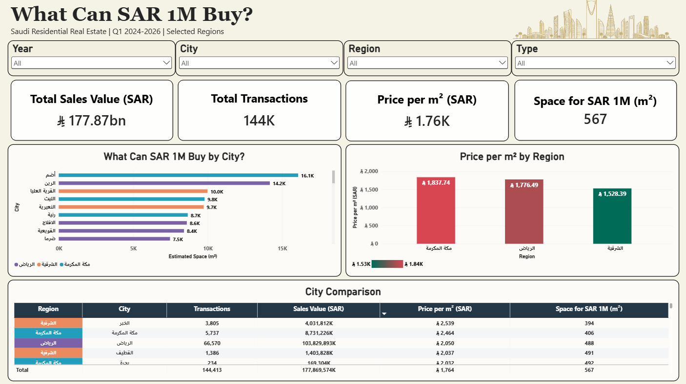
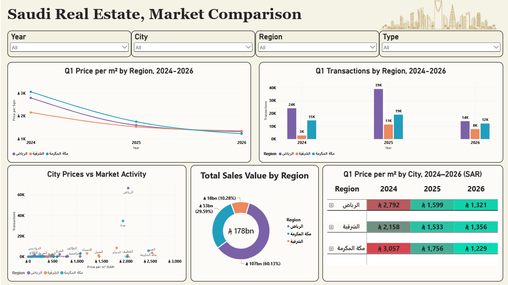

# Saudi Real Estate: What Can 1M SAR Buy?

An interactive **Power BI** dashboard exploring Saudi **residential** real estate: how much
property area a **1,000,000 SAR** budget represents, and how price per m², market activity,
and sales value compare across regions, cities, property types, and three Q1 snapshots.

**🔗 Live dashboard:** https://app.powerbi.com/view?r=eyJrIjoiZDRjYjcxZTEtMDI5ZC00MWIzLTlmOWMtNzM3NjczYTRjYjFhIiwidCI6IjFkNDRmYjJiLWJjMmYtNDI1OS1hMzc3LWU4ZGY4Y2FjZTEzYiIsImMiOjl9

## Pages

**Overview: What Can 1M SAR Buy?**



**Market Comparison (Q1 2024-2026)**



## Scope
- **Regions:** Riyadh, Makkah, Eastern Province
- **Periods:** Q1 2024, Q1 2025, Q1 2026. Three Q1 *snapshots* (not full years or a continuous quarterly series)
- **Use:** Residential only

## Tools
Power BI Desktop · Power Query (data prep) · DAX (measures) · Power BI Service (Publish to web)

## Data sources
Real Estate General Authority (**REGA**), obtained via the **Saudi Open Data Portal**
(https://open.data.gov.sa).

Nine regional *"Sales transaction indicators"* CSV files (3 regions × 3 years):

| Region | Q1 2024 | Q1 2025 | Q1 2026 |
|---|---|---|---|
| Riyadh | [dataset](https://open.data.gov.sa/en/datasets/view/05cc087e-7151-42b2-8fbe-6e41e5813201) | [dataset](https://open.data.gov.sa/en/datasets/view/c8ae6fea-4f68-436a-accc-2d83d14f0cd4) | [dataset](https://open.data.gov.sa/en/datasets/view/e2e09ba3-bb28-42ee-9f67-0e32896e4c87) |
| Makkah | [dataset](https://open.data.gov.sa/en/datasets/view/4c12f9d5-e1e4-445e-b824-96d24f4e755d) | [dataset](https://open.data.gov.sa/en/datasets/view/fb058e90-c689-4d02-adcf-8902aff3f414) | [dataset](https://open.data.gov.sa/en/datasets/view/31bd366b-8328-492e-a157-e34718372e02) |
| Eastern Province | [dataset](https://open.data.gov.sa/en/datasets/view/0761c691-7dd4-4531-b9f3-2a7e994c3e83) | [dataset](https://open.data.gov.sa/en/datasets/view/64e40f14-356b-4d1c-b3c9-a3d107eb1927) | [dataset](https://open.data.gov.sa/en/datasets/view/7ba6c161-6115-4e18-a14a-8eb25b134a1a) |

> Contains information from the nine REGA "Sales transaction indicators" datasets linked above, obtained through the Saudi Open Data Portal and made available under its [Open Data License, Version 2.0 (March 2023)](https://open.data.gov.sa/odp-public/static/en/assets/Open_Data_License_En.pdf). Data preparation and calculations are described below.

## Data preparation (Power Query)
- Imported the 9 regional CSVs; appended within each year into `Sales_2024`, `Sales_2025`, `Sales_2026`.
- Standardized columns: `Year, Quarter, Region, City, (Neighborhood), PropertyType, (Usage), TransactionCount, TotalValue, TotalArea`, published price fields.
- Replaced literal `"NULL"` text with real nulls; assigned data types; `Trim`/`Clean` on text columns.
- Kept **residential** usage; for 2024 removed commercial/agricultural based on the available labels.
- Grouped 2024 and 2025 to **city x property type** (Sum of count/value/area) to match 2026's grain; appended all into `Sales_AllYears`.
- Added columns:
  - `CalculatedPricePerSqm = if TotalArea <= 0 then null else TotalValue / TotalArea`
  - `SqmPerMillion = if CalculatedPricePerSqm <= 0 then null else 1000000 / CalculatedPricePerSqm`

## Measures (DAX)
```DAX
Total Sales Value = SUM(Sales_AllYears[TotalValue])
Total Transactions = SUM(Sales_AllYears[TransactionCount])
Total Area = SUM(Sales_AllYears[TotalArea])
Price per Sqm = DIVIDE([Total Sales Value], [Total Area])
Space for 1M SAR = DIVIDE(1000000, [Price per Sqm])
```

## Methodology note
Price per m² is an **area-weighted ratio**: `SUM(TotalValue) / SUM(TotalArea)` for the current
selection, computed from sums rather than by averaging neighborhood prices. It is **not** a median,
a constant-quality price index, REGA's official indicator, or a valuation. *"Space for 1M SAR"*
is an **estimate**, not an actual listing or offer.

## Selected findings (Q1 2026, residential)
Estimated m² a 1M SAR budget buys:

| City | Apartments | Floors |
|---|---|---|
| Riyadh | 171 | 199 |
| Jeddah | 254 | 156 |
| Khobar | 253 | 259* |

**Khobar "floors" is based on only **8** transactions (small sample).*

Highest city value per m² in 2026 (all types combined): **Al Khobar is about SAR 2,757 / m²**.

Comparison charts apply a **10-transaction minimum** filter to reduce low-volume noise (disclosed on the visual).

## Limitations
- Three **Q1 snapshots**, not full years or a continuous series.
- Source **structure differs by year** (2024/2025 neighborhood-level; 2026 city-level), and the
  count field differs (deed count vs transaction count), so comparability is approximate.
- Not all property types exist in all years; **missing does not mean zero**.
- A falling price line does **not** prove the same homes got cheaper; city/type/size composition shifts the ratio.
- Published source price indicators were not reproduced; this report uses its own consistent calculated ratio.
- Residential usage is explicit in the 2025 and 2026 files. In 2024, classification relies on the available property labels.

## Open and refresh the report
1. Use the live dashboard link above to explore the report in your browser.
2. To inspect the model and measures, download the PBIX file and open it in Power BI Desktop.
3. The saved report can be explored using its imported data. Refreshing requires access to the source CSV files.
4. Before refreshing, update the source file paths in Power Query to match their locations on your computer.
